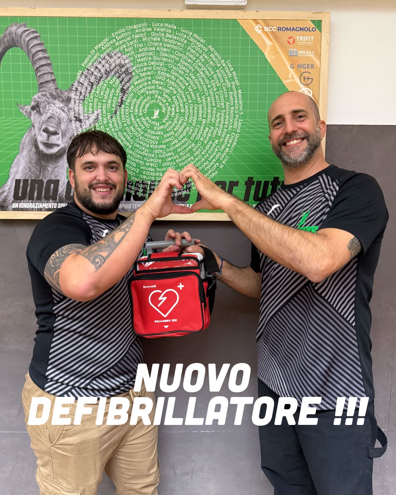

Prenderci cura di chi vive il campo è parte del nostro modo di fare squadra. Da oggi abbiamo un nuovo defibrillatore: una sicurezza in più per tutta la famiglia Saviors.

Perché ogni secondo conta e insieme possiamo fare la differenza. 🖤

Un grazie di cuore alla **Fondazione Cassa di Risparmio di Cesena** per il contributo fornito e per averci aiutato a compiere questo importante passo. 🫶🏻

  

